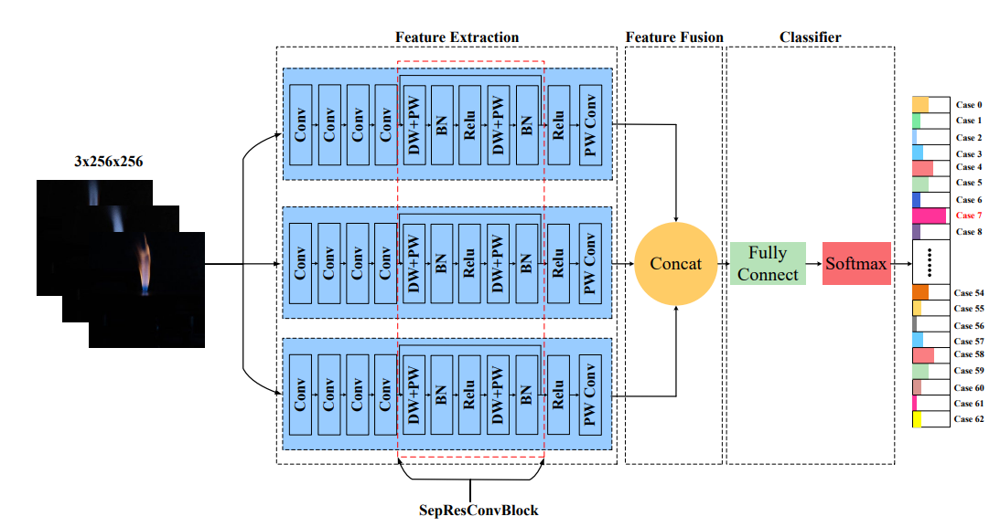
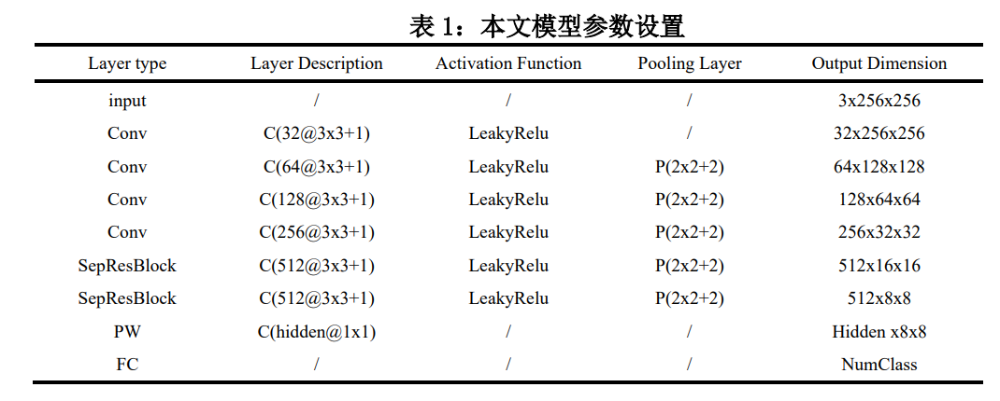
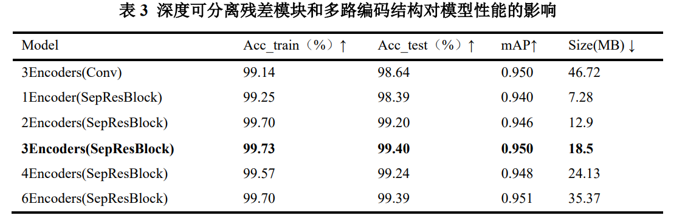
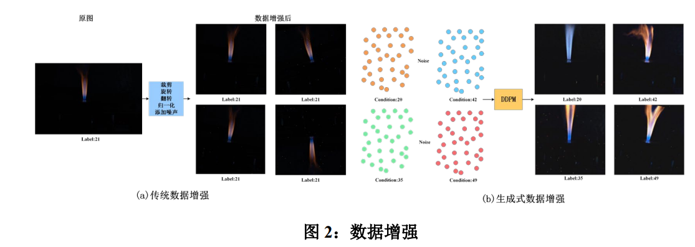

# Introduce
This repository contains the source code for our paper:

[面向复杂燃烧状态识别的多编码器特征融合模型](https://kns.cnki.net/kcms2/article/abstract?v=Jz5IuRg0t03-cDqcifcRq6-nls248fUhuHJ5p_Zi3QDebkxYyU2LI3hCN6pl_RRUlbMtUQWF7UYwf0yGYJGd794uXIQmmpYE577SeNu1qXKomemEu2KK28oANk5mzhlefaD_TVs9TPtNA1TNGDAnI4nbbvmuGsNcPCD6dLPTHrxScNaUtK40mw==&uniplatform=NZKPT)

## Summary
* A multi-encoder feature fusion model was proposed for complex combustion state recognition, where multiple parallel encoders extract complementary flame-image features and improve classification performance.
* A SepResBlock based on depthwise separable convolution and residual connections was introduced to replace standard convolutions, reducing parameter count by 61% while also lowering computational complexity.
* The method achieved 99.4% classification accuracy, and experiments showed that it outperformed conventional methods in both recognition accuracy and efficiency, with good potential for practical deployment.

## Model Architecture


## Results



## Env set
* cuda               11.8
* python             3.8.0
* conda create --name StrawSeg python=3.8.0
* Detail please reference requierment.txt

## About author
* [warren@伟](https://warren-wzw.github.io/HomePage/)
* Blog：[CSDN](https://blog.csdn.net/warren103098?type=blog)

## If this work is helpful to you, please cite it as：
```
[1]王志伟,何德峰,李廉明,等.面向复杂燃烧状态识别的多编码器特征融合模型[C]//中国自动化学会.2024中国自动化大会论文集.浙江工业大学信息工程学院;全省清洁能源转化与利用重点实验室;嘉兴新嘉爱斯热电有限公司;浙江大学能源高效清洁利用全国重点实验室;,2024:383-388.DOI:10.26914/c.cnkihy.2024.052399.
```
